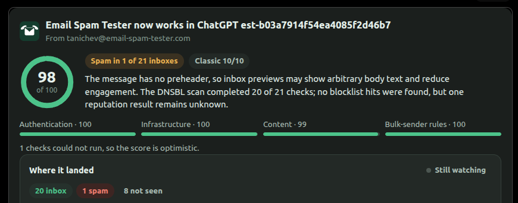

# Email Spam Tester for ChatGPT

A ChatGPT plugin that checks an email before you send it. You ask for a test address, send your draft there from the platform you normally use, and the card in the chat turns into a report a minute later.



It runs on [Email Spam Tester](https://email-spam-tester.com). This repository holds the plugin package (manifest, MCP config, icons, review test cases); the server behind it is live at `https://email-spam-tester.com/mcp`.

## What you can ask

- *Check my email for spam problems before I send it.* You get a one-hour address. The report covers SPF, DKIM and DMARC with alignment, reverse DNS, TLS, 21 blocklists, links, HTML structure, the Gmail and Yahoo bulk-sender rules, SpamAssassin and Rspamd, and ends with a fix plan.
- *Test my newsletter and show which folder it lands in at different providers.* Same send, one list of recipients and a marker for the subject. The card fills in inbox, promotions or spam provider by provider over the next half hour. The provider inboxes are shared test inboxes, so send something that is not confidential.
- *Give me a permanent address to track the welcome series of example.com.* The address stays yours. Subscribe it to your own list and every letter that arrives gets the full check; the card shows the series and what keeps going wrong in it.

The plugin never sends email and has no access to your mailbox. You send the test message yourself, from the real platform, because half of the checks read what that platform adds.

## Tools

| Tool | What it does |
|---|---|
| `get_test_address` | Reserves a single-use address for one email, optionally with provider placement |
| `wait_for_report` | Blocks until the email arrives and has been checked |
| `get_report` | Reads a report by its slug, with placement so far |
| `get_message_source` | The message as it was received: headers, text and HTML |
| `open_series_mailbox` | A permanent address for one domain's letters |
| `list_series_mailboxes` | Your permanent addresses and how many letters each has |
| `get_series_letters` | A mailbox's letters with their scores and the problems that repeat |
| `write_fix_plan` | Asks for the AI fix plan of one letter in a series |
| `close_series_mailbox` | Stops a permanent address from keeping letters |

Every tool also returns structured content for the card (`ui://widget/email-spam-tester-v3.html`, an MCP Apps resource). Clients that draw no card get the same result as text.

## Other clients

The server is a plain remote MCP server, so it works outside ChatGPT too: see [email-spam-tester-mcp](https://github.com/serg-tanichev/email-spam-tester-mcp) for Claude, Cursor, VS Code and others. Permanent mailboxes need to know who is asking and are available in ChatGPT only for now.

## Package layout

```
plugin.json   manifest: listing, review test cases, publication
mcp.json      the remote MCP server
assets/       logo, composer icon, screenshots
```

## Privacy and support

What is stored and for how long: [privacy policy](https://email-spam-tester.com/privacy/), section "Using Email Spam Tester in ChatGPT". Questions and bug reports: [hi@email-spam-tester.com](mailto:hi@email-spam-tester.com) or an issue here.

Built by [Serhii Tanichev](https://email-spam-tester.com/about/). MIT licensed.
